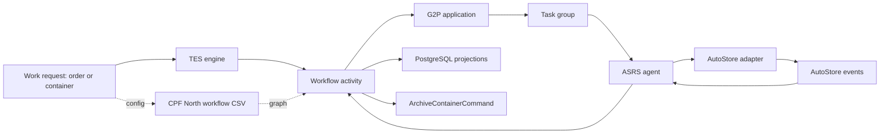

# CPF North AutoStore

## Scope

This page documents the active CPF North AutoStore configuration and its picking/putaway application boundary. It links the detailed [[CPF North AutoStore Picking Flow]] and [[CPF North AutoStore Putaway Flow]] notes.

The source of truth is the repository configuration and Java/Kotlin implementation. Rows marked as comments in configuration are not treated as active behavior.

## Latest pull alignment

The latest relevant pull is commit `3e793995a` (`#ahs - Archive container after putaway completion`). It changes the configured putaway path from the previously documented `put-container`/inactive item-handling assumption to the active `put-container-items` task, adds dedicated forklift putaway behavior, implements G2P workstation item progression, and archives the container after item putaway completes.

## Configuration map

| Concern | Active source |
|---|---|
| Workflow definitions | `resources/config/customers/ahs/cpf-north/workflows/cpf-north-autostore-workflow.csv` |
| AutoStore equipment, ports, bins, stations | `resources/config/customers/ahs/cpf-north/cpf-north-autostore.csv` |
| Agent application/controller | `tes-agent/src/main/java/com/onomatic/tes/agent/application/g2p/asrs/AsrsG2PController.java` |
| G2P application behavior | `tes-activity/src/main/java/com/onomatic/tes/activity/g2p/application/AsrsG2PApplicationDef.java` |
| Generic work/task dispatch | `tes-engine/src/main/java/com/onomatic/tes/engine/core/dispatcher/WorkDispatcher.java` |
| Workflow activity orchestration | `tes-engine/src/main/java/com/onomatic/tes/engine/core/workflow/activity/WorkflowActivityDef.java` |
| AutoStore adapter | `tes-agent/src/main/java/com/onomatic/tes/agent/manufacturer/autostore/AutostoreController.java` |
| Putaway orchestration | `tes-activity/src/main/java/com/onomatic/tes/activity/putaway/PutawayActivityDef.java` |
| Container archive helper | `tes-engine/src/main/java/com/onomatic/tes/engine/core/IQueryContextDef.java` |

## Active workflow graph

The dedicated CSV defines:

- Work request types: `order/pick` for picking and `container/putaway` for putaway.
- Workflows: `Autostore Picking` and `Autostore Putaway`.
- Picking steps: `preposition`, `pick`, and `hot-pick`.
- Putaway steps: `preposition`, `putaway`, `return`, and `hot-putaway`.
- Active putaway tasks: `put-container-items`, `handle-storage`, `preposition-tote`, and `return-tote`.
- Picking resources: the AutoStore preposition resource and pick workstations `autostore-pick-01` and `autostore-pick-02`.
- Putaway resources: the AutoStore preposition/return resources and decanting station `autostore-put-01`.

The customer equipment CSV supplies the physical model: AutoStore equipment, the G2P application, decanting and picking workstations, tote storage assets, AutoStore ports, staging positions, and bins.

## Architecture

See [[TES Workflow Concepts]], [[TES Runtime Flows]], [[TES Agent Applications StatefulApplication]], and [[TES Sagas Projections]] for the platform-level model.

## Application behavior

`AsrsG2PApplicationDef` exposes the operator-facing actions:

- `assignOrders`: resolves selected order activities, inventory snapshots, staging positions, and creates or reuses a picking task group.
- `assignContainers`: finds READY `putaway/container/put-container` requests, assigns them to a workstation staging position, and creates or reuses a putaway task group.
- `startGroup`, `pauseTasks`, `resumeTasks`, and `confirmHandling`: drive operator and equipment state.
- `refreshState` and `displayState`: rebuild the display from task-group and activity state.

The agent endpoint is exposed by `AsrsG2PController`. It lists pickable work orders at `/v1/sites/$SITE/work-orders/orders` and ready putaway containers at `/v1/sites/$SITE/tasks`.

## Current source-truth notes

1. The picking task relation in the dedicated CSV remains commented out. The active file does not prove a live `preposition completed -> pick-order` task relation.
2. The active putaway CSV selects `putaway/container/put-container-items`, not `putaway/container/put-container`. The corresponding item-aware flow is implemented by `PutawayContainerItemsTaskDef`, `ForkliftPutawayDef`, and `G2PPortWorkstationPutawayDef`.
3. `handle-storage` is still a separate task. Its completion activates `return-tote`; it is no longer the item-by-item container task described by the older notes.
4. Item putaway now drives `ActivityTaskExecution` with `ContainerPutawayExecutionTaskType.ITEM_PUT`; after the final item, the empty container is moved to its end position and the AutoStore container is archived.
5. `G2PPortWorkstationPutawayDef` completes G2P `PUT_ITEM` tasks on resource start and advances the next item after `ITEM_PUT`. It also invokes `ArchiveContainerCommand` when the item task completes.
6. The older `cpf-north-workflows.csv` contains commented ASRS rows. The dedicated AutoStore workflow CSV is the active definition used by these notes.
