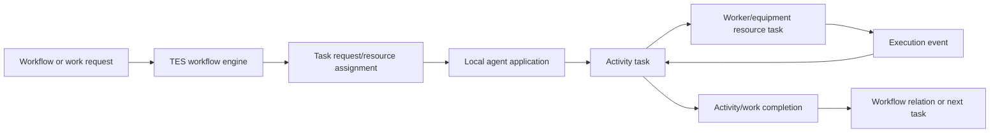

# Yourbar Chateauguay Workflow Applications

## Scope

This inventory covers the applications referenced by workflow resources under:

`resources/config/customers/yourbar/chateauguay/workflow/`

Count is documented separately in [[Yourbar Count Application]] and [[Yourbar Count Application Flow]].

## Applications referenced by workflow resources

| Application | Variant/configuration | Workflow usage |
|---|---|---|
| `$SITE/forklift-app` | `move/forklift` | Picking, receiving putaway, production picking, returns, putaway returns, summon forklift |
| `$SITE/receiving-app` | `receiving` | Planned receiving worker pool |
| `$SITE/shipping-app` | `shipping` | Shipping worker pool in `yourbar-picking.csv` |
| `$SITE/station` | `move-request/workstation-workorder` / production workstation | Production workstations, production picking/consume/switch/move-to-WIP/return |
| `$SITE/count-app` | `count` | Stock count; see linked count notes |

Configured but not directly referenced by a workflow resource row:

- `$SITE/receiving-app-unplanned`, variant `receiving/unplanned`. Its implementation is covered in [[Yourbar Receiving Application]] as an optional/manual path.

## Workflow file coverage

- `workflow/yourbar-picking.csv`: forklift picking and shipping worker pool.
- `workflow/yourbar-receiving.csv`: receiving workers and forklift putaway.
- `workflow/yourbar-production.csv`: production workstations plus production requests, pick, summon, return, and receiving tasks.
- `workflow/yourbar-summon.csv`: forklift summon activities.
- `workflow/production/yourbar-production-picking.csv`: forklift and workstation picking/replenishment.
- `workflow/production/yourbar-production-consume.csv`: workstation consumption.
- `workflow/production/yourbar-production-move-to-wip.csv`: workstation WIP moves.
- `workflow/production/yourbar-production-switch.csv`: workstation work-order switching.
- `workflow/production/yourbar-production-return.csv`: forklift and workstation returns/putaway.
- `workflow/production/yourbar-production-receiving.csv`: forklift production receiving and putaway.
- `workflow/production/yourbar-production-*.csv`: additional workstation production resources.

## Shared lifecycle

Shared orchestration is implemented by `WorkDispatcher`, `WorkflowActivityDef`, task aggregates, and application session event routing. See [[TES Runtime Flows]], [[TES Commands Events Handlers]], and [[TES Agent Applications StatefulApplication]].

## Application links

- [[Yourbar Forklift]]
- [[Yourbar Receiving Application]]
- [[Yourbar Shipping Application]]
- [[Yourbar Production Station Application]]
- [[Yourbar Count Application]]
