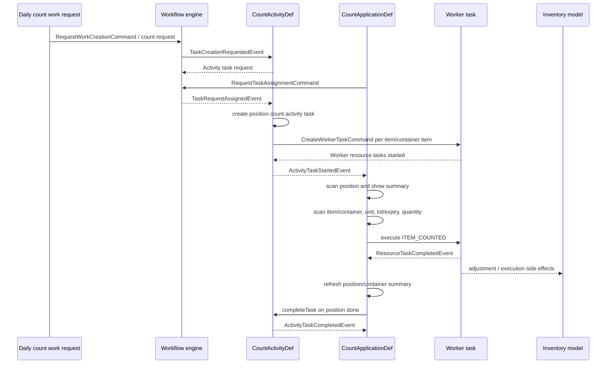

# Yourbar Count Application Flow

Parent: [[Yourbar Count Application]]  
Related: [[TES Agent Applications StatefulApplication]], [[TES Workflow Concepts]], [[TES Runtime Flows]], [[TES Commands Events Handlers]]

## End-to-end event flow

## 1. Workflow creation and assignment

The active CSV maps a daily `count/inventory/item` request to the `count/inventory/count-item` internal task.

`CountActivityDef` implements the workflow activity:

`tes-activity/src/main/java/com/onomatic/tes/activity/count/CountActivityDef.java`

Creation path:

1. `onTaskCreationRequested` accepts `InventoryCountActivityTaskType.COUNT_ITEM` only when the requester is a `WorkRequestTaskRequesterContext`.
2. It creates an activity request.
3. When the worker assigns the request, `onTaskAssigned` calls `createLocationCount`, creating an activity task at the requested position.
4. On `ActivityTaskCreatedEvent`, the activity queries inventory at the position and creates worker tasks for direct items and items inside containers.
5. The worker tasks use `WorkerTaskType.COUNT_ITEM`.
6. Resource-task creation is immediately started by the count activity/list definitions.

The list wrapper is:

`tes-activity/src/main/java/com/onomatic/tes/activity/count/task/CountInventoryDef.java`

It is registered for `count/inventory/count-item` and auto-starts resource tasks when they are created. Individual entries use:

`tes-activity/src/main/java/com/onomatic/tes/activity/count/task/CountItemTaskDef.java`

## 2. Stateful session startup

The session implementation is:

`tes-activity/src/main/java/com/onomatic/tes/activity/count/application/CountSessionDef.java`

It accepts count activity events and resource events associated with the worker session. It also binds the forklift from an equipment session or selected forklift.

The state machine is implemented by:

`tes-activity/src/main/java/com/onomatic/tes/activity/count/application/state/CountApplicationState.java`

and

`tes-activity/src/main/java/com/onomatic/tes/activity/count/application/state/CountApplicationFlow.java`

Startup behavior:

1. `Initialize` receives `ApplicationInitializationRequestedEvent`.
2. If no forklift is confirmed, transition to `SelectForklift`.
3. A valid forklift barcode calls `setForklift`, assigns the application session, then resumes counting.
4. `resumeCount` searches for active count activity tasks assigned to the worker.
5. If none is active, `assignNextTaskRequest` finds the next READY `count-item` request and sends `RequestTaskAssignmentCommand`.
6. If a task is active, the application resumes at its position summary.
7. If no request is available, it displays `NO_COUNT_REQUEST`.

## 3. Position state

When the activity task starts, the application receives `ActivityTaskStartedEvent` and enters `ScanPositionState`. The operator must scan the configured task position.

A valid position transitions to:

`CountPositionSummaryState`

This state builds the current summary from:

- open worker count tasks;
- completed work-item executions;
- latest execution per item/identification/position key.

Actions:

- `ADD_ITEM`: count an unaccounted item at the position.
- `ADD_CONTAINER`: count/create a container at the position.
- `POSITION_COUNT_DONE`: display confirmation and call `completeTask(taskId)`.

## 4. Item and container selection

`CountPositionSummaryState.onBarcodeScanned` handles:

- an execution/internal ID, to revisit a previously counted item;
- a container barcode, to enter `CountContainerSummaryState`;
- an item barcode, to select matching open worker tasks;
- invalid scans, with `INVALID_ENTRY`;
- an item found only inside a container, with `ITEM_REQUIRES_CONTAINER_SCAN`.

Container behavior:

- If the container has open count tasks at the current position, the application shows its contents.
- If it is at a different position, it enters `CountUnexpectedContainerConfirmationState`.
- If it was previously counted, it supports re-entry through the completed worker tasks.

The container summary supports adding items/counts and closing the container back to the position summary.

## 5. Tracking, unit, and quantity capture

The common transition logic is in `CountApplicationFlow`:

1. Filter candidate tasks by start position, item number, lot, lot sequence, and expiry.
2. Resolve item master and inventory/count unit.
3. If multiple units exist, enter `CountUnitCaptureState`; if one exists, select it automatically.
4. Apply container configuration:
   - pallet-only handling units force a full pallet;
   - non-pallet handling units permit mixed/full selection;
   - unresolved handling units require configured container options.
5. For tracked items, enter the appropriate state:
   - `CountLotCaptureState`;
   - `CountLotSequenceCaptureState`;
   - `CountExpiryCaptureState`.
6. Enter `CountQuantityCaptureState`.
7. Quantity validation leads to `CountConfirmationState`.

The state files are:

- `tes-activity/src/main/java/com/onomatic/tes/activity/count/application/state/CountItemCaptureState.java`
- `tes-activity/src/main/java/com/onomatic/tes/activity/count/application/state/CountUnitCaptureState.java`
- `tes-activity/src/main/java/com/onomatic/tes/activity/count/application/state/CountItemIdentificationState.java`
- `tes-activity/src/main/java/com/onomatic/tes/activity/count/application/state/CountQuantityCaptureState.java`
- `tes-activity/src/main/java/com/onomatic/tes/activity/count/application/state/CountUnexpectedContainerConfirmationState.java`

## 6. Count confirmation and inventory effect

`CountConfirmationState` aggregates repeated entries for the same item/identification.

On `CountAction.CONFIRM_QUANTITY`:

1. For an unaccounted count, it can issue `RequestContainerCreationCommand` using the selected output container type.
2. It creates and prints the container label when a forklift printer is available.
3. It creates a new `WorkerTask` if no existing task was selected.
4. It creates a `ResourceTaskItemExecution` with the entered quantity.
5. It executes the worker task with `WorkerTaskExecutionType.ITEM_COUNTED`.
6. On resource-task completion, it displays `ITEM_COUNTED` and returns to position or container summary.

Relevant source:

`tes-activity/src/main/java/com/onomatic/tes/activity/count/application/state/CountConfirmationState.java`

The item adjustment event model is defined in:

`tes-coreapi/src/main/java/com/onomatic/tes/coreapi/item/events.kt`

The worker execution definitions are in:

`tes-coreapi/src/main/java/com/onomatic/tes/coreapi/task/worker/definitions.kt`

## 7. Activity completion

For a position count, `POSITION_COUNT_DONE` calls `completeTask`. The workflow activity then emits the normal activity completion/task lifecycle events described in [[TES Commands Events Handlers]] and [[TES Axon Aggregates]].

The application responds to `ActivityTaskCompletedEvent` by returning to `NoCountTaskState`. The operator can refresh, receive the next assigned request, or exit.

Container completion returns to the position summary rather than completing the whole position task immediately. This permits multiple containers/items to be counted before the position is closed.

## 8. Yourbar-specific asynchronous processor

`tes-engine/src/main/java/com/onomatic/tes/engine/core/processor/StockcountProcessor.java` is not the primary count UI handler. It contains unrelated Yourbar replenishment reactions:

- `ItemAdjustedEvent` for positions beginning `A-R01-S01` can create replenishment work when quantity falls below configured minimum.
- `ContainerPickedEvent` at `HT-BX` can create automatic hot-box replenishment work for a single-item container.
- An older automatic “create stock count after an unaccounted pick” handler is commented out and inactive.

## Traceability summary

- Workflow: `resources/config/customers/yourbar/chateauguay/workflow/yourbar-count.csv`
- Application registration: `resources/config/customers/yourbar/chateauguay/yourbar-chateauguay.csv`
- Forklift menu: `resources/config/customers/yourbar/chateauguay/asset/yourbar-forklifts.csv`
- Application definition: `tes-activity/src/main/java/com/onomatic/tes/activity/count/application/CountApplicationDef.java`
- Session: `tes-activity/src/main/java/com/onomatic/tes/activity/count/application/CountSessionDef.java`
- State machine: `tes-activity/src/main/java/com/onomatic/tes/activity/count/application/state/`
- Activity: `tes-activity/src/main/java/com/onomatic/tes/activity/count/CountActivityDef.java`
- Agent: `tes-agent/src/main/java/com/onomatic/tes/agent/application/count/`
