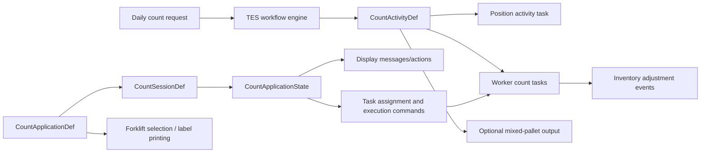

# Yourbar Count Application

## Scope

This page documents the Yourbar Chateauguay stock-count application. The detailed operator state machine and event flow are in [[Yourbar Count Application Flow]].

Related platform notes: [[TES Agent Applications StatefulApplication]], [[TES Workflow Concepts]], [[TES Runtime Flows]], [[TES Commands Events Handlers]], and [[TES Sagas Projections]].

## Configuration

Primary workflow source:

`resources/config/customers/yourbar/chateauguay/workflow/yourbar-count.csv`

Application and worker source:

- `resources/config/customers/yourbar/chateauguay/yourbar-chateauguay.csv`
- `resources/config/customers/yourbar/chateauguay/asset/yourbar-forklifts.csv`

Active graph:

| CSV element | Value |
|---|---|
| Workflow | `stockcount`, “Stock Count”, ACTIVE |
| Step | `stockcount/stockcount`, type `count/inventory`, zone `$SITE/WH` |
| Resource | `$SITE/stockcount/stockcount/workers`, worker pool `count/inventory/workers`, application `$SITE/count-app` |
| Request | `count-request`, type `count/inventory/item`, job type `$SITE/daily` |
| Task | `count-item`, internal type `count/inventory/count-item` |
| Output asset | `count-pallet-mix`, type `count/inventory/container`, asset type `$SITE/CONTAINER/pallet-mix` |
| Step property | `item/label-document = document_type/YBF-ONO/DOCUMENT/zpl-item` |

The customer configuration registers `count-app` as a local-agent application with variant `count`. The worker pool contains the configured Yourbar workers. The forklift application menu exposes Count as the second item under `$SITE/forklift-menu`.

## Architecture

## Application construction

`CountApplicationDef` extends `StatefulApplicationDef<CountSessionDef>`.

- It accepts only the `CountApplicationType` application variant.
- It creates a `CountSessionDef` only for an `IWorkerAwareSession`.
- The session uses the selected or session-bound forklift.
- The initial state is `CountApplicationState.Initialize`.

The runtime factory is:

`tes-activity/src/main/java/com/onomatic/tes/activity/ActivityDefFactory.java`

The agent builder/controller paths are:

- `tes-agent/src/main/java/com/onomatic/tes/agent/application/count/CountBuilder.java`
- `tes-agent/src/main/java/com/onomatic/tes/agent/application/count/CountController.java`
- `tes-agent/src/main/java/com/onomatic/tes/agent/application/count/CountRestController.java`
- `tes-agent/src/main/java/com/onomatic/tes/agent/application/count/CountSimulator.java`

REST requests are rooted at `/api/applications/count` by `CountRestController`; websocket/application actions use the shared application controller infrastructure.

## Count domain types

Definitions are in:

`tes-coreapi/src/main/java/com/onomatic/tes/coreapi/activity/count/definitions.kt`

- Activity: `CountActivityType.INVENTORY`.
- Worker pool: `InventoryCountWorkerType.WORKERS`.
- Request: `InventoryCountRequestType.ITEM`, work type COUNT.
- Activity task: `InventoryCountActivityTaskType.COUNT_ITEM`.
- Executions: `COUNT_ITEM` and `COUNT_NEW_ITEM`.
- Task group: `CountTaskGroupType.COUNT_ITEMS`, configured not to close automatically on task-list completion.
- Default count tolerance: 95, from `CountInventoryProperties`.

Application actions/messages are in:

`tes-coreapi/src/main/java/com/onomatic/tes/coreapi/application/type/count/definitions.kt`

Actions include item/lot/expiry entry, unit and quantity changes, count confirmation, adding a container, closing a position/container, refresh, and accepting a moved container.

## Source-truth caveats

- The CSV uses an `ACTIVITY` row for `count-request`; it is not the older generic `REQUEST` shape from `resources/config/onomatic/data/workflow/stockcount.csv`.
- `CountActivityDef` explicitly rejects workflow orders: count is position/item based, not order based.
- The CSV configures a mixed-pallet output, but the actual container is created only when the operator counts an unaccounted item/container and chooses a container type.
- `CountApplicationFlow.MANUAL_PALLET_TYPE_SELECTION` is true, so compatible mixed/full container choices can be presented.
- `WorkerTaskType.COUNT_ITEM` declares `ITEM_PUT` as its default execution in `tes-coreapi/.../task/worker/definitions.kt`, while the count UI explicitly executes `WorkerTaskExecutionType.ITEM_COUNTED`. The explicit count flow is the behavior to trace.
- `StockcountProcessor` contains a commented-out handler for creating counts after an unaccounted pick; that automatic path is inactive in the current source.
