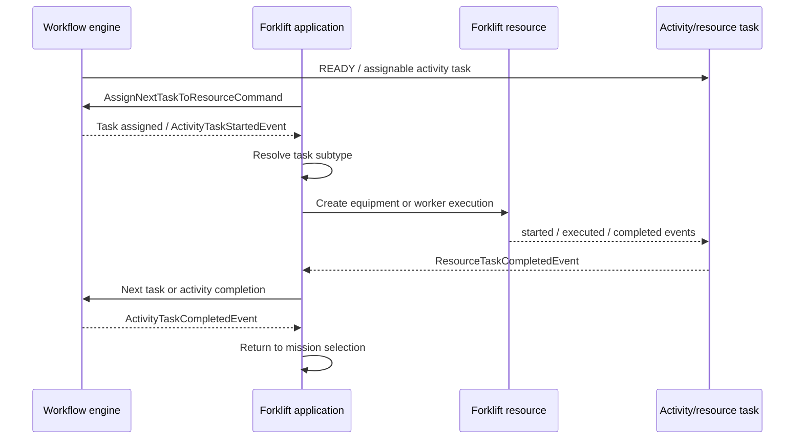

# Yourbar Forklift Application

Parent: [[Yourbar Chateauguay Workflow Applications]]  
Related: [[Yourbar Receiving Application]], [[Yourbar Production Station Application]], [[TES Runtime Flows]], [[TES Agent Applications StatefulApplication]]

## Configuration usage

The application is registered in:

`resources/config/customers/yourbar/chateauguay/asset/yourbar-forklifts.csv`

`forklift-app` has variant `move/forklift`. The forklift menu exposes it as “Exécuter une mission”. Workflow resources bind it to:

- `workflow/yourbar-picking.csv`: `pick/order/forklift`.
- `workflow/yourbar-receiving.csv`: `putaway/container/forklift`.
- `workflow/yourbar-summon.csv`: `summon/equipment/forklift`.
- `workflow/production/yourbar-production-picking.csv`: pick/replenishment forklift tasks.
- `workflow/production/yourbar-production-receiving.csv`: dispatch, receiving, and putaway forklift tasks.
- `workflow/production/yourbar-production-return.csv`: return and putaway-return forklift tasks.

The physical resource is `$SITE/forklifts`, containing `forklift-01`, `forklift-02`, and `forklift-03`.

## Event flow

## Session and mission selection

Implementation:

- `tes-activity/src/main/java/com/onomatic/tes/activity/move/application/ForkliftMoveApplicationDef.java`
- `tes-activity/src/main/java/com/onomatic/tes/activity/move/application/ForkliftMoveSessionDef.java`
- `tes-activity/src/main/java/com/onomatic/tes/activity/move/application/state/ForkliftApplicationState.java`

The application accepts both equipment and worker sessions. On initialization it:

1. Binds a configured forklift or asks the operator to scan/select one.
2. Finds an active worker/equipment task.
3. Otherwise displays mission selection.
4. `START` sends `AssignNextTaskToResourceCommand`.
5. Assignment/start events select the subtype-specific mission state.

The state dispatcher recognizes container putaway, equipment dispatch, order picking, putaway items, receiving, returns, and summon tasks. The same application is therefore the execution surface for several workflows, not a forklift-only domain workflow.

## Execution types

The application delegates to activity/task implementations:

- Pick: `tes-activity/src/main/java/com/onomatic/tes/activity/pick/`
- Putaway: `tes-activity/src/main/java/com/onomatic/tes/activity/putaway/`
- Receiving: `tes-activity/src/main/java/com/onomatic/tes/activity/receiving/`
- Return: `tes-activity/src/main/java/com/onomatic/tes/activity/returns/`
- Dispatch/move: `tes-activity/src/main/java/com/onomatic/tes/activity/move/` and `dispatch/`
- Summon: `tes-activity/src/main/java/com/onomatic/tes/activity/move/application/SummonApplicationState.java`

Physical forklift resource adapters publish resource execution events; application state consumes them and advances the mission.

## Important distinction

The workflow CSV assigns activities to `forklift-app`, but the application does not itself decide workflow semantics. The activity definitions create the resource tasks and interpret `ITEM_PICKED`, `CONTAINER_DROPPED`, `ITEM_RECEIVED`, move, return, and summon execution types.
