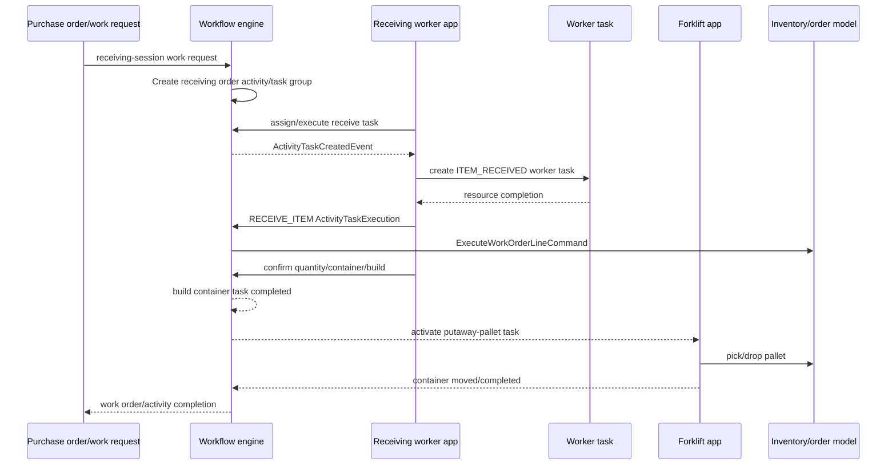

# Yourbar Receiving Application

Parent: [[Yourbar Chateauguay Workflow Applications]]  
Related: [[Yourbar Forklift]], [[TES Workflow Concepts]], [[TES Runtime Flows]]

## Configuration usage

Planned receiving is configured in:

`resources/config/customers/yourbar/chateauguay/workflow/yourbar-receiving.csv`

- Workflow: `$SITE/receiving`.
- Receiving activity: `receiving/order`, zone `$SITE/DK`.
- Worker pool resource: `receiving/order/workers`, application `$SITE/receiving-app`.
- Forklift putaway resource: `putaway/container/forklift`, application `$SITE/forklift-app`.
- Request: `receiving-session`, job type `$SITE/daily`.
- Tasks: receive items, build pallet/mix pallet, then putaway full/mix pallet.
- Active relations: build pallet completed activates full-pallet putaway; build mix pallet completed activates mix-pallet item putaway.
- Receiving starts at `$SITE/DK-DK`, stages at `$SITE/dk-staging`, and putaway targets warehouse rack/floor bins.

The receiving workflow also configures label output `document_type/YBF-ONO/DOCUMENT/zpl-item` and disables automatic quantity-to-handling conversion.

## Event flow

## Planned receiving application

Implementation:

- `tes-activity/src/main/java/com/onomatic/tes/activity/receiving/application/ReceivingApplicationDef.java`
- `tes-activity/src/main/java/com/onomatic/tes/activity/receiving/application/ReceivingSessionDef.java`
- `tes-activity/src/main/java/com/onomatic/tes/activity/receiving/application/state/ReceivingApplicationState.java`
- `tes-agent/src/main/java/com/onomatic/tes/agent/application/receiving/ReceivingBuilder.java`
- `tes-agent/src/main/java/com/onomatic/tes/agent/application/receiving/ReceivingController.java`

A worker session is initialized through dock, dock-bin, printer, order, item, handling-unit, lot/expiry, quantity, and confirmation states. The application can create a receipt/task group, receive item quantities, create containers, and close the receipt.

## Activity/task behavior

`ReceivingActivityDef`:

- creates receiving order sessions or build-container activity tasks;
- creates a receiving task group for order sessions;
- creates order activity tasks per work order;
- creates build-container tasks at the container position;
- selects worker-pool or forklift resource implementations.

`ReceiveOrderDef`:

- creates worker or equipment item-receive tasks;
- on resource completion emits `OrderReceivingTaskType.RECEIVE_ITEM` with KEEP_ACTIVE;
- directly executes work-order lines through `ExecuteWorkOrderLineCommand`;
- completes the work order with `CompleteWorkOrderCommand` when the activity task completes.

`ReceiveInventoryDef` completes its list when all item tasks are complete. The build-container completion relations in the CSV then activate the configured putaway task.

## Unplanned receiving

The customer registers `receiving-app-unplanned` with variant `receiving/unplanned` in:

`resources/config/customers/yourbar/chateauguay/yourbar-chateauguay.csv`

Its implementation is:

- `tes-activity/src/main/java/com/onomatic/tes/activity/receiving/application/UnplannedReceivingApplicationDef.java`
- `tes-activity/src/main/java/com/onomatic/tes/activity/receiving/application/UnplannedReceivingSessionDef.java`
- `tes-activity/src/main/java/com/onomatic/tes/activity/receiving/application/state/UnplannedScanItem.java`

The source supports creating an ad hoc receipt/task group from scanned items and containers. No workflow resource row in the Chateauguay workflow folder currently binds `receiving-app-unplanned`; treat it as configured capability, not an active CSV workflow path.
