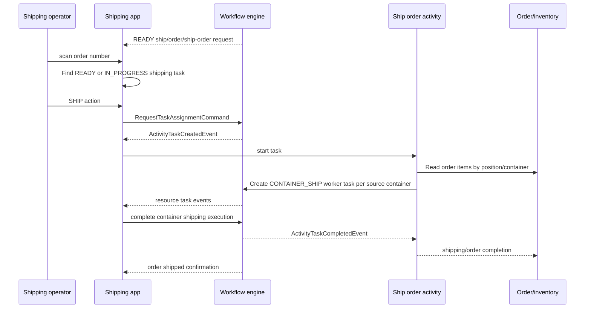

# Yourbar Shipping Application

Parent: [[Yourbar Chateauguay Workflow Applications]]  
Related: [[TES Runtime Flows]], [[TES Workflow Concepts]], [[TES REST APIs]]

## Configuration usage

Shipping is referenced by:

`resources/config/customers/yourbar/chateauguay/workflow/yourbar-picking.csv`

The `$SITE/picking/pick` activity uses forklift picking, while `$SITE/picking/ship` uses:

- resource class: `WORKER_POOL`;
- type: `ship/order/workers`;
- resource: `$SITE/workers`;
- location: `$SITE/DK-DK`;
- application: `$SITE/shipping-app`.

The shipping activity starts at `$SITE/DK-DK` and ends at `$SITE/dk-shipped`. Its priority is `P0R1` FIFO.

## Event flow

## Implementation

- Application: `tes-activity/src/main/java/com/onomatic/tes/activity/shipping/ShippingApplicationDef.java`
- Session: `tes-activity/src/main/java/com/onomatic/tes/activity/shipping/ShippingSessionDef.java`
- State machine: `tes-activity/src/main/java/com/onomatic/tes/activity/shipping/state/ShippingApplicationState.java`
- Agent builder/controller: `tes-agent/src/main/java/com/onomatic/tes/agent/application/shipping/ShippingBuilder.java`, `ShippingController.java`
- Activity: `tes-activity/src/main/java/com/onomatic/tes/activity/shipping/ShippingActivityDef.java`
- Task: `tes-activity/src/main/java/com/onomatic/tes/activity/shipping/task/ShippingOrderDef.java`

The application accepts worker sessions and only count/ship activity events for the Ship activity parent. It shows READY/IN_PROGRESS shipping tasks by order reference.

## Task creation

`ShippingActivityDef` builds a shipping activity request from work-order lines and the configured start/end positions. It activates the request.

After `SHIP`:

1. The application assigns the task request to the current worker.
2. On activity task creation, it starts the task.
3. It groups order items by source container position.
4. It creates a `WorkerTaskExecutionType.CONTAINER_SHIP` task for each container, moving it to the shipping end position.
5. `ShippingOrderDef` completes the activity task once no resource task remains.
6. The application receives `ActivityTaskCompletedEvent`, displays ORDER_SHIPPED, and returns to order selection.

If no order lines are found, the application displays `NO_ORDER_LINES`.
