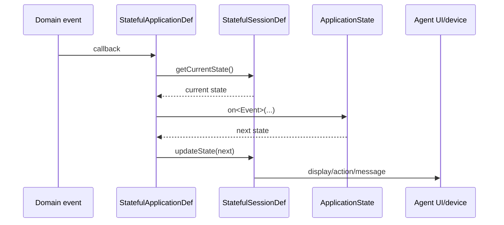

# TES Agent Applications and StatefulApplication

There are two related layers:

1. `tes-agent` configured applications/sessions, builders, controllers and device-facing REST/WebSocket behavior.
2. `tes-engine`/`tes-activity` application definitions that react to domain events.

## StatefulApplicationDef

`StatefulApplicationDef<T extends StatefulSessionDef>` extends `ApplicationDef`. For each supported event it:

1. obtains the current `ApplicationState<T>`;
2. calls the matching `state.on<Event>(session, event, context)`;
3. stores the returned state with `session.updateState(state)`.

Supported inputs include application initialization/input, activity/resource task lifecycle, task groups, work requests, item receipt/pick/put/adjustment, equipment/device input/state and session inactivation.

Concrete activity definitions include ASRS/carousel G2P, receiving/unplanned/returns, forklift move, worker/workstation/WO production, cart/cluster/AMR picking, putwall/worker consolidation, APM, count, shipping and admin/light assignment.

## Task-group application events

These callbacks describe the lifecycle of a `TaskGroup` as observed by an application session. They are notifications of task-group events, not commands to change the group. The task-group aggregate updates its own status as part of the corresponding lifecycle event.

| Event | Meaning | Important detail |
|---|---|---|
| `onTaskGroupCreated` | The task group has been created with its initial definition. | The group is initially in `CREATED`; it may not yet be dispatched, assigned, ready, or started. |
| `onTaskGroupReady` | The group has become available to start. | The group status becomes `READY`. In the generic work model, this can also happen again after `PAUSED`; it is not necessarily the first event after creation. |
| `onTaskGroupRefreshed` | A refresh/snapshot notification has been requested for the group. | It does not represent a lifecycle transition and does not change the status. The event carries the current group payload and status, so consumers can synchronize or rebuild their view. |
| `onTaskGroupStarted` | Execution of the group has begun or resumed. | The group status becomes `IN_PROGRESS`. The event includes `fromStatus`, which distinguishes a first start from a resume, such as `PAUSED` → `IN_PROGRESS`. The engine permits starting from `CREATED`, `ASSIGNED`, `READY`, or `PAUSED`. |
| `onTaskGroupPaused` | Execution has been suspended. | The group status becomes `PAUSED`; it can subsequently become `READY` or be started again. |
| `onTaskGroupCompleted` | The group has actually finished and transitioned to `DONE`. | This is emitted after completion is requested and the group has no remaining active tasks. It is different from requesting completion: the request asks the group to finish its tasks, while this event confirms that it did. |

In the normal lifecycle, a group may move through `CREATED` → `READY` → `IN_PROGRESS` → `PAUSED`/`IN_PROGRESS` → `DONE`, but the engine also permits direct starts from some earlier states and repeated refresh notifications. `TaskGroupSubmittedEvent` and `TaskGroupScheduledEvent` exist at the task-group level, but they are not exposed as callbacks by `ApplicationSessionEventListener` alongside the application-state callbacks listed above.

Agent composition: `ConnectorFactory` selects builders; builders create controllers/sessions; sessions use query/routing services and display widgets/actions.

This is a session/application behavior layer, not an Axon aggregate.

Related: [[TES Workflow Concepts]], [[TES Runtime Flows]], [[TES RabbitMQ Topology]].

Source: `tes-engine/src/main/java/com/onomatic/tes/engine/core/model/application/StatefulApplicationDef.java`; `tes-engine/src/main/java/com/onomatic/tes/engine/core/model/application/ApplicationDef.java`; `tes-engine/src/main/java/com/onomatic/tes/engine/core/model/session/StatefulSessionDef.java`; `tes-engine/src/main/java/com/onomatic/tes/engine/core/model/application/state/`; `tes-activity/src/main/java/com/onomatic/tes/activity/*/application/`; `tes-agent/src/main/java/com/onomatic/tes/agent/application/`; `tes-agent/src/main/java/com/onomatic/tes/agent/connector/ConnectorFactory.java`.
