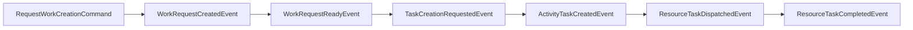

# TES Commands, Events and Handlers

Commands/events are primarily defined in `tes-coreapi` by domain package: work, task, workflow, application, device, equipment, item, container, position, order and site.

Common command families:

- Work lifecycle: request/create, activate, start, pause, execute, complete, cancel, reset, update, assign/unassign, priority.
- Task lifecycle: task/request/group create, submit, dispatch, assign, start, pause, execute, complete, cancel, refresh.
- Workflow configuration: CRUD for graph steps, resources, requests, orders, assets, rules and relations.
- Inventory: container/item/asset/location creation, movement and adjustment.
- Agent: initialize session, receive input, execute action and acknowledge messages.
- Integration: import external work/order/job and export selected events.

Handlers live in aggregates, `WorkDispatcher`, `TaskDispatcher`, broker services, event listeners and activity definitions. Exact paths are listed below.

Related: [[TES Axon Aggregates]], [[TES Runtime Flows]], [[TES Workflow Concepts]].

Source: `tes-coreapi/src/main/java/com/onomatic/tes/coreapi/`; `tes-engine/src/main/java/com/onomatic/tes/engine/core/dispatcher/WorkDispatcher.java`; `tes-engine/src/main/java/com/onomatic/tes/engine/core/dispatcher/TaskDispatcher.java`; aggregate packages under `tes-engine`, `tes-config`, `tes-inventory`.
