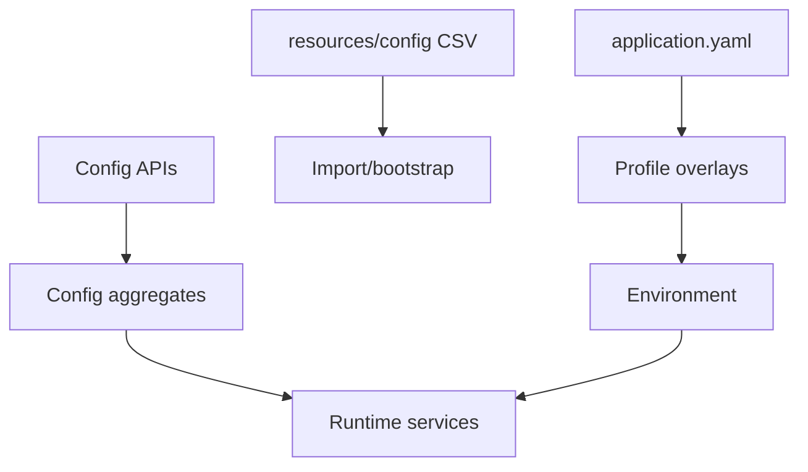

# TES Configuration

Configuration is layered across root/profile YAML, environment variables, runtime config aggregates and CSV bootstrap data.

Root defaults include port 8080, app name `tes-app`, API `/api`, UI `/spa`, tenant header `X-Tenant-Id`, WebSocket `/ws`, STOMP prefixes, device outbound `/device/outbound`, and disabled-by-default Axon Server/distributed/Consul/GCP integrations.

Configuration aggregates cover sites, systems, users, applications/sessions, workflows, workers/pools, zones, equipment/pools, resources, connectors, devices, agents, integrations, webhooks, item/container/order/job types and security metadata.

CSV resources contain workflow, customer/site, equipment, worker, layout, item, inventory and connector data. They are bootstrap/configuration data, separate from event state.

Authentication is intentionally profile-specific; do not infer credentials from root config.

Related: [[TES Bounded Contexts]], [[TES Deployment Architecture]], [[TES Workflow Concepts]].

Source: `tes-app/src/main/resources/application.yaml`; `tes-app/src/main/resources/application-*.yaml`; `tes-config/src/main/java/com/onomatic/tes/config/`; `tes-agent/src/main/resources/`; `resources/config/`.

## Workflow CSV import model

Workflow CSVs are graph bootstrap files, not execution logs. A file may contain any of these sections:

- Workflow: root identity, reference, display name and status.
- WorkflowStep: activity/stop nodes with sequence, zone, type and properties.
- WorkflowOrder: workflow-level, step-level and batch order templates.
- WorkflowAsset: workflow input and step input/output asset lineage.
- WorkflowPosition: workflow, step and resource location constraints.
- WorkflowResource: worker/equipment pool bound to an activity.
- WorkflowRequest: workflow or activity work request template.
- WorkflowTask: task template, direction, type, parent request and sequence.
- WorkflowTaskRelation: event-driven activation from one task to another.
- WorkflowPriority and WorkflowRule: ordering, filtering and eligibility.

References such as $SITE/stockcount/stockcount are resolved into typed IDs and parent references during import. The resulting configuration is persisted as workflow aggregates and read models; the workflow engine later materializes it as a WorkflowGraph.

The configuration-domain implementation is:

- Workflow aggregate/command handling: tes-config/src/main/java/com/onomatic/tes/config/workflow/WorkflowAggregate.java and WorkflowCommandHandler.java
- CSV/API mapping: tes-config/src/main/java/com/onomatic/tes/config/workflow/WorkflowMapper.java
- Configuration service/API: tes-config/src/main/java/com/onomatic/tes/config/workflow/WorkflowService.java and WorkflowRestController.java
- Projection/read models: tes-config/src/main/java/com/onomatic/tes/config/workflow/persistence/WorkflowProjector.java, entities.kt and views.kt

## Example: Yourbar count CSV

The active file is:

resources/config/customers/yourbar/chateauguay/workflow/yourbar-count.csv

Its graph is intentionally request-driven and has no WorkflowOrder section:

~~~mermaid
flowchart TB
    WF[stockcount workflow] --> STEP[stockcount activity step]
    STEP --> RES[count inventory worker pool]
    STEP --> REQ[count/inventory/item request]
    REQ --> TASK[count/inventory/count-item task]
    STEP --> ASSET[count/inventory/container output asset]
    TASK --> ACT[CountActivityDef]
    ACT --> WT[worker count tasks]
    WT --> APP[CountApplication session]
~~~

Because CountActivityDef rejects workflow orders, this workflow starts from a daily count request and creates position/item count work rather than order-line work. See [[Yourbar Count Application]] and [[TES Workflow Concepts]].
