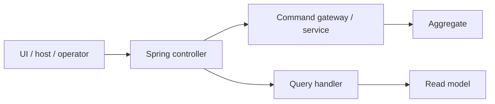

# TES REST APIs

HTTP surfaces:

- Core operational routes under `tes.api.base-path`, default `/api`.
- UI facade routes under `/api/ui/**`.
- Agent, application/session and manufacturer integration endpoints in `tes-agent`.

Representative routes:

- `/api/v1/sites/{site}/work-orders`
- `/api/v1/sites/{site}/containers`
- `/api/ui/tasks`
- workflow-specific CRUD under `tes-config`
- agent configuration endpoints exposing broker connection configuration

`tes-webui-api` controllers map UI DTOs to core DTOs and services, then map responses back. Engine/config/inventory controllers expose operational and master-data routes. Agent controllers are backed by builder/controller/session objects and device-specific integrations.

Swagger/OpenAPI support is in the build; `api-docs.json` feeds generated client code.

Source: `tes-app/src/main/resources/application.yaml`; `tes-webui-api/src/main/java/com/onomatic/tes/webui/api/`; `tes-engine/src/main/java/com/onomatic/tes/engine/*/*RestController.java`; `tes-config/src/main/java/com/onomatic/tes/config/*/*RestController.java`; `tes-inventory/src/main/java/com/onomatic/tes/inventory/*/*RestController.java`; `tes-agent/src/main/java/com/onomatic/tes/agent/`; `api-docs.json`.
