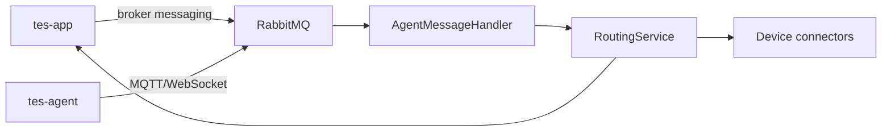
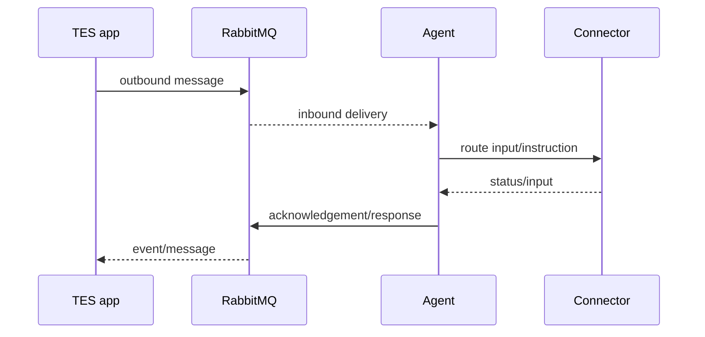

# TES RabbitMQ Topology

RabbitMQ is supplied by custom Docker images. Agent messaging uses MQTT over WebSocket as well as broker-facing services; the repository does not contain one canonical exchange/queue/binding inventory.

Compose ports:

- `5672`: AMQP
- `15672`: management
- `15675`: MQTT WebSocket

Important properties:

- `TES_BROKER_DEFAULT_HOST`
- `TES_BROKER_DEFAULT_MQTT_URL`
- `tes.broker.default.mqtt-url`
- `tes.device-router.outbound-destination` defaults to `/device/outbound`

Treat broker-image defaults and environment-specific bindings as deployment configuration.

Source: `resources/docker-compose.yml`, `resources/docker-compose-local.yml`, `resources/onomatic-demo-compose.yaml`; `tes-message-broker/src/main/java/com/onomatic/tes/broker/`; `tes-message-broker/src/main/java/com/onomatic/tes/agent/`; `tes-agent/src/main/java/com/onomatic/tes/agent/AgentInitializer.java`; `tes-agent/src/main/java/com/onomatic/tes/agent/AgentMessageHandler.java`.
