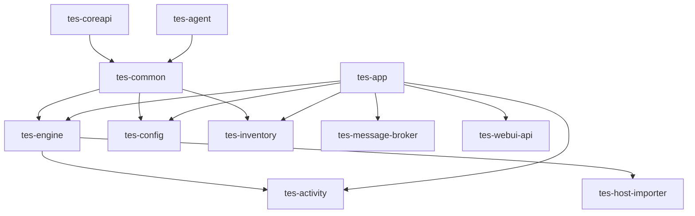

# TES Spring Boot Modules

Modules in `settings.gradle`:

- `tes-coreapi`: shared domain model/contracts.
- `tes-common`: cross-cutting Axon, JPA, security, tenant, query and projection infrastructure.
- `tes-config`: configuration/master-data aggregates and APIs.
- `tes-engine`: workflow, work/task execution, dispatchers and orchestration.
- `tes-inventory`: physical inventory and asset domains.
- `tes-activity`: operational activity definitions/state machines.
- `tes-host-importer`: external order/job/work import.
- `tes-host-exporter`: event export and webhooks.
- `tes-message-broker`: agent messaging and message persistence.
- `tes-webui-api`: web UI API facade.
- `tes-agent`: agent runtime and device/application integrations.
- `tes-app`: assembled Spring Boot application.
- `tes-simulator`: generators/simulators.
- `tes-test`: fixtures/test support.

The root build targets Java 21/Kotlin, Spring Boot, Axon, JPA, RabbitMQ, Consul, WebSocket and OpenAPI. Published container-oriented projects are `tes-app` and `tes-agent`.

Source: `settings.gradle`, `build.gradle`, module `build.gradle` files.
