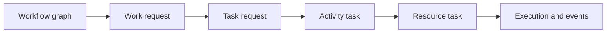

# TES Workflow Concepts

A workflow is configured graph structure; work/tasks are runtime instances.

- Graph nodes include tasks, resources, requests, orders, assets, properties, rules, priorities and relations.
- Work requests are requested execution.
- Task requests can fan out into activity tasks.
- Resource tasks bind work to worker/equipment/resource.
- Task groups coordinate or refresh related tasks.
- Orchestrators model position/resource availability and queuing.

Generic lifecycle vocabulary includes created, ready, started, paused, executed, completed, cancelled, reset and error. Activity/aggregate rules determine valid transitions.

`WorkDispatcher` creates/fans out work and tasks. `TaskDispatcher` assigns eligible next tasks and periodically activates overdue work/refreshes priorities. Activities specialize execution for receiving, picking, move, production, consolidation, G2P, shipping, count, APM and returns.

CSV examples include receiving, picking, inbound orders/shipments, stock count, putwall consolidation, ASRS G2P and production workflows.

Related: [[TES Axon Aggregates]], [[TES Runtime Flows]], [[TES Agent Applications StatefulApplication]].

Source: `tes-engine/src/main/java/com/onomatic/tes/engine/core/workflow/`; `tes-engine/src/main/java/com/onomatic/tes/engine/core/dispatcher/`; `tes-engine/src/main/java/com/onomatic/tes/engine/core/model/`; `tes-config/src/main/java/com/onomatic/tes/config/workflow/`; `resources/config/onomatic/data/workflow/`.

## Workflow graph model

A configured workflow is a WorkflowGraph, not just a list of steps. The graph contains:

| Graph element | Meaning | Typical relationship |
|---|---|---|
| Workflow | Named, enabled definition selected by workflow ID/reference | Root of all graph nodes |
| Step | Ordered execution location or stop | Belongs to a workflow |
| Activity step | Executable step with an activity type, zone, requests, tasks, resources, assets, orders, priorities and positions | Specialized WorkflowStep |
| Stop step | Non-activity terminal/control step | Specialized WorkflowStep |
| Request | Work-intent template, either workflow input/group or activity request | May reference an activity and expose properties |
| Task | Task template describing direction, type, parent request and sequence | Belongs to an activity |
| Task relation | Event-driven edge between two workflow tasks | sourceTask -> targetTask |
| Order | Order template or step order input; can contain batches, rules and priorities | Workflow- or step-scoped |
| Asset | Workflow input or step input/output representing a container, tote, pallet, item or storage object | Has parent/step/type/direction |
| Resource | Worker pool, equipment pool, workstation or other execution capacity | Bound to an activity |
| Position | Start/end/staging/storage location constraint | Workflow-, step- or resource-scoped |
| Rule/priority | Filters, ordering and eligibility constraints | Attached to orders, tasks, resources or priorities |

The graph implementation is in:

- tes-coreapi/src/main/java/com/onomatic/tes/coreapi/workflow/graph/graph.kt
- tes-coreapi/src/main/java/com/onomatic/tes/coreapi/workflow/graph/step.kt
- tes-coreapi/src/main/java/com/onomatic/tes/coreapi/workflow/graph/order.kt
- tes-coreapi/src/main/java/com/onomatic/tes/coreapi/workflow/graph/request.kt
- tes-coreapi/src/main/java/com/onomatic/tes/coreapi/workflow/graph/task.kt
- tes-coreapi/src/main/java/com/onomatic/tes/coreapi/workflow/graph/taskrelation.kt

WorkflowDef materializes this graph into runtime definition objects. It indexes activities, requests, orders, assets, resources, tasks, positions and relations, and resolves them by IDs, types, barcodes and positions:

tes-engine/src/main/java/com/onomatic/tes/engine/core/workflow/WorkflowDef.java

## CSV section mapping

Customer and platform workflow CSVs are sectioned configuration imports:

| CSV section | Runtime meaning |
|---|---|
| Workflow | Workflow identity, name and status |
| WorkflowStep | Ordered activity/stop nodes, step type, zone and properties |
| WorkflowOrder | Workflow-level or step-level order templates, parent/step/type/direction |
| WorkflowAsset | Workflow input or step asset lineage, type and direction |
| WorkflowPosition | Location/start/end/staging/storage positions |
| WorkflowResource | Worker/equipment resource bound to an activity |
| WorkflowRequest | Work request template bound to a workflow/activity |
| WorkflowTask | Task template bound to an activity/request |
| WorkflowTaskRelation | Event-triggered task activation chain |
| WorkflowPriority | Priority definitions and selection behavior |
| WorkflowRule | Order/task/priority/resource filtering and eligibility rules |

CSV rows use references such as $SITE/stockcount/stockcount; the importer resolves them into typed IDs and parent relationships. Commented rows are not active graph nodes.

## Workflow step semantics

A step is the unit that provides execution context:

1. The step selects an activity implementation from its configured activity type.
2. The step zone constrains where work may occur.
3. Step sequence provides ordering metadata, but does not by itself replace task relations.
4. Requests and tasks under the step define what work can be created.
5. Resources provide eligible execution capacity.
6. Positions resolve where assets begin/end or where a resource may stage.
7. Step assets define the physical lineage entering or leaving the step.
8. Step orders define the order-specific work lines handled at that step.

WorkflowActivityDef creates the concrete activity implementation and coordinates task creation, assignment, start, execution and completion:

tes-engine/src/main/java/com/onomatic/tes/engine/core/workflow/activity/WorkflowActivityDef.java

The activity factory selects specialized implementations such as receiving, picking, move, count, putaway, G2P, shipping and production:

tes-activity/src/main/java/com/onomatic/tes/activity/ActivityDefFactory.java

## Requests, tasks and task relations

A workflow request is a template for creating runtime work. An activity request is associated with a specific activity and can carry typed properties. A workflow task is a template; it becomes a runtime task request only when the dispatcher evaluates the request and its workflow context.

A task relation is the primary configured dependency mechanism:

~~~mermaid
flowchart LR
    R[Work request ready] --> CR[Create task request]
    CR --> TR[Task request ready]
    TR --> AT[Activity task]
    AT --> RT[Resource task]
    RT --> EX[Resource execution]
    EX --> EC[Activity task completed]
    EC --> REL{Workflow task relation}
    REL --> NEXT[Activate next task]
~~~

Relations carry:

- parent: workflow scope;
- sourceTask: task whose lifecycle is observed;
- targetTask: task to activate;
- type: usually TRIGGER;
- onEvent: for example task/created or task/completed;
- action: usually ACTIVATE;
- stage: task/resource/activity stage.

A configured step sequence is descriptive/order metadata. A relation explicitly defines event-driven activation. This distinction is visible in the AutoStore CSV where the picking preposition-to-pick relation is commented out, while the putaway handle-tote relations are active.

Relation definitions:

tes-coreapi/src/main/java/com/onomatic/tes/coreapi/workflow/task/relation/definitions.kt

Runtime evaluation:

tes-engine/src/main/java/com/onomatic/tes/engine/core/workflow/activity/WorkflowActivityDef.java

## Workflow orders

Workflow orders are templates for order-shaped work, not runtime customer orders.

Important graph forms:

- WorkflowOrderInput: workflow-level order input selected by an order type.
- WorkflowStepOrderInput: order input scoped to a step; it points to a parent order and step.
- WorkflowOrderBatch: child/batch under a step order.

Step orders can carry priorities and rules. The engine uses the step order to map order lines into the activity task/request context, resolve the step location/zone, and select matching priorities. Order rules filter which orders or lines are accepted; task rules filter task/resource eligibility.

Sources:

- tes-coreapi/src/main/java/com/onomatic/tes/coreapi/workflow/order/definitions.kt
- tes-coreapi/src/main/java/com/onomatic/tes/coreapi/workflow/order/model.kt
- tes-engine/src/main/java/com/onomatic/tes/engine/core/workflow/order/WorkflowOrderInputDef.java
- tes-engine/src/main/java/com/onomatic/tes/engine/core/workflow/order/WorkflowStepOrderDef.java

Runtime order flow:

~~~mermaid
sequenceDiagram
    participant Host as Host/API order
    participant Work as Work/order model
    participant Graph as WorkflowGraph
    participant Step as WorkflowStepOrderDef
    participant Activity as WorkflowActivityDef
    participant Tasks as Task requests

    Host->>Work: Create work order and lines
    Work->>Graph: Resolve workflow/order type
    Graph->>Step: Resolve matching step order
    Step->>Step: Apply order rules and priorities
    Step->>Activity: Build step/order context
    Activity->>Tasks: Create requests/tasks for accepted lines
    Tasks-->>Activity: Ready/assigned/executing lifecycle
~~~

Count is intentionally different: CountActivityDef rejects workflow orders and creates position/item count work from a workflow request. AutoStore picking, inbound/outbound and production flows use order or step-order structures where their CSVs define them.

## Concrete example: Yourbar stock count

Source:

resources/config/customers/yourbar/chateauguay/workflow/yourbar-count.csv

The file defines a minimal request-driven graph:

- Workflow: stockcount, ACTIVE.
- WorkflowStep: stockcount/stockcount, activity type count/inventory, zone $SITE/WH, sequence 1.
- WorkflowResource: worker pool count/inventory/workers, application $SITE/count-app.
- WorkflowRequest: count-request, activity request type count/inventory/item, job type $SITE/daily.
- WorkflowTask: count-item, internal task type count/inventory/count-item, direction INTERNAL, parent request count-request.
- WorkflowAsset: count-pallet-mix, step output asset of type count/inventory/container and asset type $SITE/CONTAINER/pallet-mix.

Runtime chain:

1. A daily count work request is created against stockcount.
2. The dispatcher evaluates the configured request/task template.
3. A READY count-item task request is assigned to the count worker pool.
4. CountActivityDef creates a position activity task and worker tasks for inventory at that position.
5. CountApplicationDef scans position/item/container data and executes count entries.
6. ITEM_COUNTED executions update count state and inventory projections.
7. Position completion completes the activity task; the application looks for the next READY count request.

Detailed behavior: [[Yourbar Count Application]], [[Yourbar Count Application Flow]].

## Configuration versus runtime state

Workflow CSV data defines reusable templates and relationships. It does not represent a live work order, task request, resource assignment or execution event.

~~~mermaid
flowchart TB
    CSV[CSV workflow templates] --> CFG[Workflow configuration aggregates]
    CFG --> GRAPH[Materialized WorkflowGraph]
    HOST[Host/API work request] --> DISP[WorkDispatcher]
    GRAPH --> DISP
    DISP --> WR[Work request]
    WR --> TR[Task request]
    TR --> AT[Activity task]
    AT --> RT[Resource task]
    RT --> EV[Execution events]
    EV --> PROJ[Runtime projections]
~~~

Configuration is managed by WorkflowAggregate, WorkflowCommandHandler, WorkflowProjector and WorkflowService; execution is handled by WorkDispatcher, TaskDispatcher and activity definitions.

## Workflow configuration APIs

Workflow configuration is editable through the config service as well as CSV bootstrap:

- Workflow and step CRUD/query endpoints: tes-config/src/main/java/com/onomatic/tes/config/workflow/WorkflowRestController.java
- Commands and orchestration: WorkflowService.java and WorkflowCommandHandler.java
- Read models: WorkflowQueryService.java
- Configuration projections/repositories: tes-config/src/main/java/com/onomatic/tes/config/workflow/persistence/
- DTO-to-domain graph mapping: WorkflowMapper.java

Workflow configuration changes emit configuration-domain events and update projections. They do not execute work until a runtime request is created against the resulting graph.

## Related notes

- [[TES Configuration]]
- [[TES Runtime Flows]]
- [[TES Commands Events Handlers]]
- [[TES Axon Aggregates]]
- [[CPF North AutoStore]]
- [[Yourbar Count Application]]
